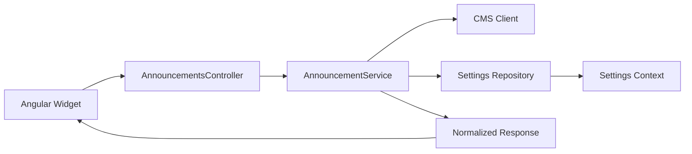

# MuniAnnouncements_RA

Microservice for announcements and updates displayed on municipal websites.

## Structure

- `backend/MuniAnnouncements.Api` - C# API built on .NET 10.
- `Repositories` - CMS and site-settings interfaces, with an in-memory context and hard-coded repositories for the demo.
- `Services` - announcement filtering, normalization, truncation and sorting.
- `Controllers` - HTTP endpoint boundary.
- `backend/MuniAnnouncements.Api.Tests` - unit and HTTP automation tests for normalization and the API.
- `client` - responsive, RTL-aware and accessible standalone Angular widget.

## Architecture




## Step-by-Step Run Instructions

From the repository root:

```powershell
dotnet test backend\MuniAnnouncements.Api.Tests\MuniAnnouncements.Api.Tests.csproj
dotnet run --project backend\MuniAnnouncements.Api\MuniAnnouncements.Api.csproj --urls http://localhost:5000
```

The test suite includes 7 unit tests for normalization logic and 3 HTTP automation tests that run the API in memory and verify existing tenants, data isolation and `404 Not Found` for an unknown authority.

In a separate terminal:

```powershell
cd client
npm install
npm start
```

The API is available at `GET http://localhost:5000/announcements/api/6500`.
The client is available at `http://localhost:4200`.

## Create the MongoDB Collection

The migration script is located at `scripts/mongodb/001-create-authority-site-settings.js`.
It creates `AuthoritySiteSettings` and adds a unique index on `authorityCode`. It does not insert seed data.

```powershell
$env:MONGO_DATABASE = "MuniSites"
mongosh "mongodb://localhost:27017" --file scripts/mongodb/001-create-authority-site-settings.js
```

You can replace `MONGO_DATABASE` with the desired database name.

After creating the collection, apply the schema validator:

```powershell
mongosh "mongodb://localhost:27017" --file scripts/mongodb/002-add-authority-site-settings-schema.js
```

The validator enforces required fields, data types and `maxItems`.

To insert sample settings for the two municipalities:

```powershell
mongosh "mongodb://localhost:27017" --file scripts/mongodb/003-seed-authority-site-settings.js
```

The seed script uses upsert to update each municipality's settings document without creating duplicates. Business rules, such as enabled categories and announcement validity, remain in the service layer.

## Response Contract

The service returns `404` when no settings exist for the requested authority code. Otherwise, it returns the authority name and a list of announcements that passed:

1. `Published` status.
2. A publication date in the past and an expiry date that has not been reached.
3. A category enabled in the site settings.
4. A display category name, urgency flag and plain-text summary of up to 150 characters.
5. Urgent announcements first, followed by publication date from newest to oldest, limited to `maxItems`.

The CMS and MongoDB integrations are represented by repository implementations. Site settings are accessed through `IAuthoritySiteSettingsContext`, which represents an in-memory collection, and then through `AuthoritySiteSettingsRepository`. The Context is registered as Singleton and the Repository as Scoped. Replacing the Context with a real Mongo implementation would not require changes to the service or controller. The evaluation time is passed to the service as a parameter, keeping normalization deterministic in tests without an additional time abstraction.

## Multi-Tenancy

Every request includes `authorityCode` in the route. The code is filtered in the CMS repository, checked against `AuthoritySiteSettings`, and filtered again in the business service to protect against an external source returning data for another tenant. The demo contains tenants `6500` and `7000`, and the automation tests verify their data isolation.

`authorityCode` identifies a tenant but is not authentication or authorization. Adding user permissions requires an identity contract from the hosting platform and is therefore outside this demo's scope.


## AI Usage Disclosure

GitHub Copilot in Visual Studio Code was used to assist with project scaffolding, C# and Angular implementation, unit/integration test generation, README drafting and review of edge cases. The solution, assumptions, architecture and final changes were reviewed and validated manually with .NET tests, Angular build and JavaScript syntax checks.